# JAX para Software Devs: De Python y NumPy a Cómputo Acelerado con OpenXLA

- **Por qué es relevante:** JAX permite escribir funciones matemáticas en Python con la misma API de `numpy` y transformarlas mediante un compilador (`@jax.jit`, `jax.grad`, `jax.vmap`) en binarios nativos de OpenXLA que corren en CPU, GPU y Cloud TPU sin escribir un solo kernel en C++ o CUDA.
- **Para quién es:** Ingenieros de software, desarrolladores backend y científicos de datos que dominan Python y NumPy, pero nunca han usado JAX ni necesitan venir del mundo de PyTorch o Deep Learning.
- **Quién debería verlo:** Desarrolladores que construyen simulaciones de Montecarlo, motores de riesgo o precios, calibración de sensores, optimización numérica o procesamiento de datos por `batches` y buscan eliminar `for-loops` lentos de Python.
- **Serie completa:** Punto de entrada de la Serie B [JAX & ML for Software Devs Field Guide](https://github.com/ykro/jax-ml-for-software-devs-field-guide) (y compañero de la Serie A [JAX & OpenXLA Field Guide](https://github.com/ykro/jax-openxla-field-guide)).

---

## Arquitectura y Modelo Mental

### 1. De `numpy` a `jax.numpy` e Inmutabilidad Funcional (`.at[].set()`)

En NumPy, una asignación como `arr[:, 0] = val` muta el buffer en RAM in-place y arriesga efectos secundarios si otra función comparte la referencia. En JAX, los arrays son inmutables por diseño para que el compilador OpenXLA pueda fusionar operaciones y reutilizar buffers PJRT sin race conditions. Las actualizaciones se expresan de forma pura con `arr.at[:, 0].set(val)`.



### 2. Cómo Piensa `@jax.jit`: Tracing vs Ejecución Compilada

Cuando decoras una función con `@jax.jit`, la primera llamada con una firma `(shape, dtype)` ejecuta el código Python pasando objetos abstractos `ShapedArray` para grabar las operaciones en un grafo `Jaxpr` y compilarlo a `StableHLO`. En las llamadas subsecuentes con la misma forma geométrica, JAX salta el intérprete de Python y hace `dispatch` directo al binario XLA en caché.



### 3. Transformaciones Componibles: `jit(vmap(value_and_grad(f)))`

En lugar de programar derivadas manuales o `for-loops` para recorrer un `batch`, en JAX escribes una función escalar limpia para un solo registro (`1D`) y compones transformaciones de orden superior como `jax.value_and_grad`, `jax.vmap` y `@jax.jit` en una sola línea.



---

## Resultados Reales de Verificación (`verify_fundamentals.py`)

Benchmarks deterministas ejecutados con Python `3.12.11`, JAX `0.12.0.1` y NumPy `2.5.4` en CPU. Cada tiempo es la **mediana por llamada** (después de una llamada de calentamiento que compila), así una máquina con otros procesos corriendo no distorsiona tanto el resultado; el juez solo exige mínimos razonables de speedup y verifica de forma estricta la paridad numérica, el conteo de traces y el determinismo.

| Experimento | Archivo | Baseline (NumPy / Eager / Loop) | JAX + OpenXLA | Speedup / Verificación |
| :--- | :--- | :--- | :--- | :--- |
| **01. `jnp` & `.at[].set()` Simulation** | `experiments/01_numpy_to_jax_arrays.py` | `4.6996 ms` (JAX Eager) / `6.1456 ms` (NumPy) | `0.3412 ms` (`@jax.jit`) | **13.78x** vs Eager / **18.01x** vs NumPy (`max_diff = 1.53e-05`) |
| **02. `@jit` Tracing vs Cached Exec** | `experiments/02_jit_tracing_vs_execution.py` | `0.5119 ms` (NumPy Eager) | `0.0992 ms` (Cached `@jit`) | **5.16x** (`1 trace` para 3 llamadas con mismo `shape`, `2` con un `shape` nuevo; Jaxpr de `15` ecuaciones, `61` líneas de StableHLO) |
| **03. `value_and_grad` vs Finite Diff** | `experiments/03_grad_as_code_transformation.py` | `1.8646 ms` (Finite Diff, 64 evals) | `0.0576 ms` (`@jit(value_and_grad)`) | **32.39x** (`loss` baja **376.48x** en 20 steps) |
| **04. `vmap` Batch (10,000 records)** | `experiments/04_vmap_goodbye_for_loops.py` | `33.2483 ms` (Python `for-loop`) | `0.1606 ms` (`@jit(vmap)`) | **207.02x** (`max_diff = 1.19e-07`) |
| **05. Parallel Threefry PRNG Keys** | `experiments/05_deterministic_prng_keys.py` | `428.3968 ms` (`loop` secuencial completo, 2048 workers) | `9.0142 ms` (`@jit(vmap)` sobre 2048 keys) | **47.52x** (Orden-invariante, `Δ = 0.0`) |

Salida íntegra de terminal generada por `verify_fundamentals.py`:

```text
==============================================================================
THE OUTSIDE JUDGE — JAX for Software Devs Verification Report
==============================================================================
Runtime : Python 3.12.11 | JAX 0.12.0.1 | NumPy 2.5.4 | Backend: cpu
------------------------------------------------------------------------------
Experiment                         | Baseline       | JAX/OpenXLA    | Speedup / Check
------------------------------------------------------------------------------
01. jnp & .at[].set() Simulation   | 4.6996 ms      | 0.3412 ms      | 13.78x (PASS)  
02. @jit Tracing vs Cached Exec    | 0.5119 ms      | 0.0992 ms      | 5.16x (1 trace)
03. value_and_grad vs Finite Diff  | 1.8646 ms      | 0.0576 ms      | 32.39x (PASS)  
04. vmap Batch (10,000 records)    | 33.2483 ms     | 0.1606 ms      | 207.02x (PASS) 
05. Parallel Threefry PRNG Keys    | 428.3968 ms    | 9.0142 ms      | 47.52x (Δ=0.0) 
------------------------------------------------------------------------------
Saved JSON report to: benchmarks/latest_results.json
ALL DETERMINISTIC CHECKS PASSED.
```

------------------------------------------------------------------------------
Experiment                         | Baseline       | JAX/OpenXLA    | Speedup / Check
------------------------------------------------------------------------------
01. jnp & .at[].set() Simulation   | 3.9126 ms      | 0.2724 ms      | 14.36x (PASS)  
02. @jit Tracing vs Cached Exec    | 0.5089 ms      | 0.0921 ms      | 5.53x (1 trace)
03. value_and_grad vs Finite Diff  | 1.6547 ms      | 0.0565 ms      | 29.29x (PASS)  
04. vmap Batch (10,000 records)    | 31.7093 ms     | 0.1466 ms      | 216.32x (PASS) 
05. Parallel Threefry PRNG Keys    | 408.6253 ms    | 8.6511 ms      | 47.23x (Δ=0.0) 
------------------------------------------------------------------------------
Saved JSON report to: benchmarks/latest_results.json
ALL DETERMINISTIC CHECKS PASSED.
```

---

## Estructura del Repositorio

```text
.
├── benchmarks/
│   ├── latest_results.json                  # Métricas verificadas por verify_fundamentals.py
│   └── terminal_output.txt                  # Salida íntegra del Outside Judge
├── diagrams/
│   ├── 01-numpy-vs-jax-immutability.{html,svg,png}
│   ├── 02-jit-tracing-mental-model.{html,svg,png}
│   └── 03-composable-transforms-pipeline.{html,svg,png}
├── experiments/
│   ├── 01_numpy_to_jax_arrays.py            # De NumPy a jax.numpy e inmutabilidad con .at[].set()
│   ├── 02_jit_tracing_vs_execution.py       # Tracing con ShapedArray, Jaxpr, StableHLO y lax.cond
│   ├── 03_grad_as_code_transformation.py    # Autodiff exacto vs diferencias finitas (sin Deep Learning)
│   ├── 04_vmap_goodbye_for_loops.py         # Vectorización automática de 10,000 registros sin for-loops
│   └── 05_deterministic_prng_keys.py        # PRNG Threefry determinista y paralelizable con split + vmap
├── gcp/
│   └── run_on_demand_benchmark.sh           # Runner on-demand con auto-teardown en Cloud TPU v5e y L4 GPU
├── tests/
│   └── test_fundamentals.py                 # Suite pytest determinista (5 tests)
├── Makefile
├── pyproject.toml
└── verify_fundamentals.py                   # El Outside Judge (aserciones de paridad y speedup)
```

---

## Onboarding Paso a Paso

### 1. Instalación desde cero (macOS / Linux)

```bash
git clone https://github.com/ykro/jax-for-software-devs.git
cd jax-for-software-devs
python3 -m venv .venv
source .venv/bin/activate
pip install --upgrade pip
pip install -e ".[dev]"
```

### 2. Recorrido guiado por los 5 experimentos (Orden recomendado)

Cada script toma unos pocos segundos y explica un pilar del modelo mental de JAX para ingenieros de software:

```bash
# Paso 1 — De numpy a jax.numpy, inmutabilidad y actualizaciones puras con .at[].set()
python experiments/01_numpy_to_jax_arrays.py

# Paso 2 — Cómo piensa @jax.jit: ShapedArray tracing, Jaxpr, StableHLO y condicionales
# (--show-ir imprime además el Jaxpr completo y el inicio del módulo StableHLO)
python experiments/02_jit_tracing_vs_execution.py --show-ir

# Paso 3 — jax.grad como transformación de código: calibración de sensores vs diferencias finitas
python experiments/03_grad_as_code_transformation.py

# Paso 4 — Adiós a los for-loops: procesar un batch de 10,000 registros con jax.vmap
python experiments/04_vmap_goodbye_for_loops.py

# Paso 5 — Aleatoriedad determinista y paralelizable con jax.random.key y split
python experiments/05_deterministic_prng_keys.py
```

### 3. Verificación completa (Linter + Tests + Outside Judge)

```bash
# Ejecutar únicamente el Outside Judge y actualizar benchmarks/latest_results.json
python verify_fundamentals.py

# Ejecutar ruff, pytest (5 tests) y verify_fundamentals.py en un solo comando
make all
```

### 4. Ejecución on-demand con auto-teardown en Google Cloud (Cloud TPU v5e o NVIDIA L4 GPU)

El script `gcp/run_on_demand_benchmark.sh` aprovisiona instancias on-demand con auto-teardown en el proyecto `ai-experiments-487722` y garantiza la limpieza automática de los recursos mediante `trap cleanup EXIT INT TERM`.

```bash
# Ejecutar benchmark en una instancia on-demand de Cloud TPU v5e-1 (us-central1-a)
make gcp-tpu

# Ejecutar benchmark en un Vertex AI Custom Job on-demand con GPU NVIDIA L4
make gcp-gpu
```
